# 🔍 Campus Lost & Found

<div align="center">

[](https://lost-found-campus-based-system.vercel.app/)
[](https://campus-lostfound-api.onrender.com/api/health)
[](https://github.com/abhishekn4352/Campus-Lost-and-Found/actions)
[](LICENSE)

A full-stack web app for college campuses. Students report **lost** items, post **found** items, **claim** what's theirs and chat to arrange the handover — all while keeping phone numbers and emails private until both parties agree.

**[Live Demo](https://lost-found-campus-based-system.vercel.app/)** · **[API Docs](#-api-reference)** · **[Deployment Guide](DEPLOYMENT.md)** · **[Report Bug](https://github.com/abhishekn4352/Campus-Lost-and-Found/issues)**

</div>

<p align="center">
  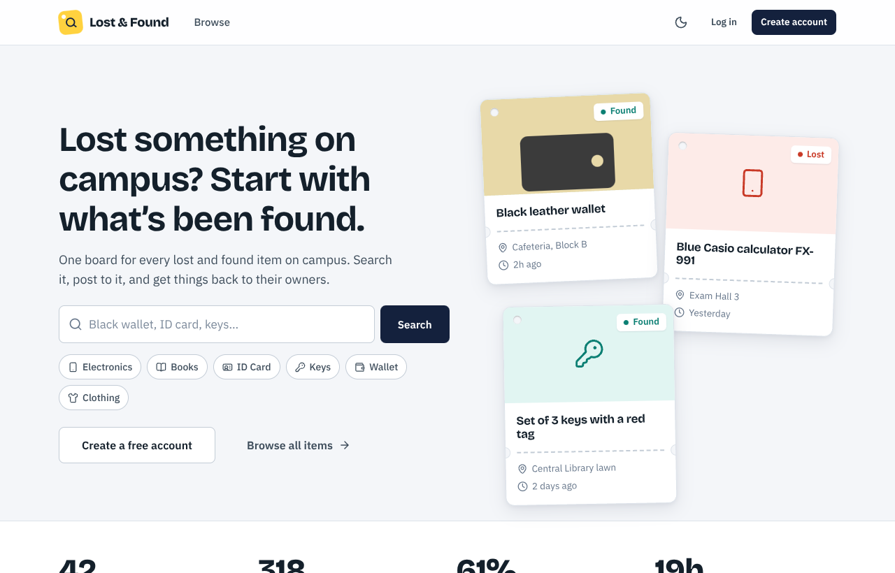
</p>

---

## 🏗️ Tech Stack

<div align="center">

| Layer | Technology |
|-------|-----------|
| **Frontend** | React 18, Vite, React Router 6, Lucide Icons, Custom Design System |
| **Backend** | Node.js, Express.js, JWT Authentication, Multer |
| **Database** | MongoDB with Mongoose ODM |
| **Email** | Brevo HTTP API (production) / Nodemailer Gmail SMTP (development) |
| **Push** | Web Push with VAPID keys |
| **DevOps** | Docker, nginx, GitHub Actions CI, Vercel + Render |

</div>

---

## ✨ Features

<table>
<tr><td>

### 📋 Item Board
- Browse and search lost/found items
- Filter by type, category, location
- Sort by date, relevance
- Paginated results with shareable URLs

### 🔐 Privacy First
- Phone & email hidden by default
- Contact shared **only** when both users consent
- Enforced at API level, not just UI

### 💬 Private Chat
- One chat per item
- Real-time messaging between finder & owner
- Contact details revealed only after mutual agreement

</td><td>

### 📝 Claims System
- Claimants must provide proof of ownership
- Finder manually reviews and approves/rejects
- Atomic approval — rival claims auto-rejected
- Full claim lifecycle tracking

### 👤 Multi-Session Auth
- Each browser tab has its own login
- Password or email-code login
- Change email with verification
- One account per college ID

### 🔔 Push Notifications
- Browser push for new messages, claims, decisions
- Works even when site is closed
- Privacy-safe — no message content in notifications

</td></tr>
</table>

### 🛡️ Admin Panel
Dashboard overview • Searchable items/claims/users • Delete content • Resolve claims • Suspend/reinstate accounts

### ⏰ Housekeeping
Posts auto-close after 30 days • Abandoned sign-ups cleaned daily • Auto cron jobs

---

## 📸 Screenshots

<table>
<tr>
<td align="center">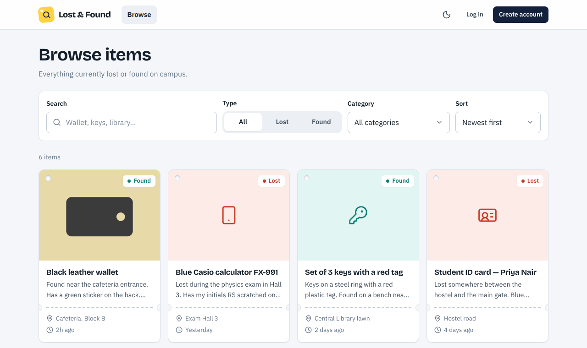<br><b>Browse & Search</b></td>
<td align="center">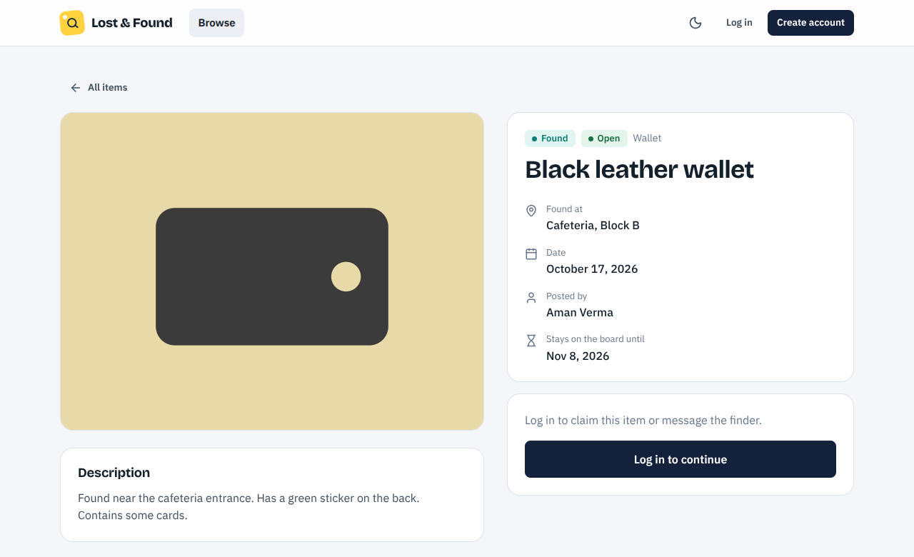<br><b>Item Detail</b></td>
</tr>
<tr>
<td align="center">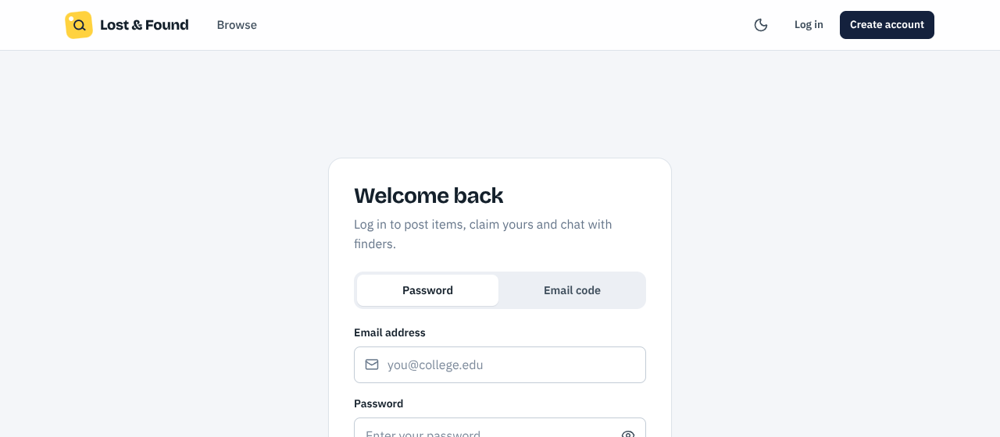<br><b>Claims Review</b></td>
<td align="center">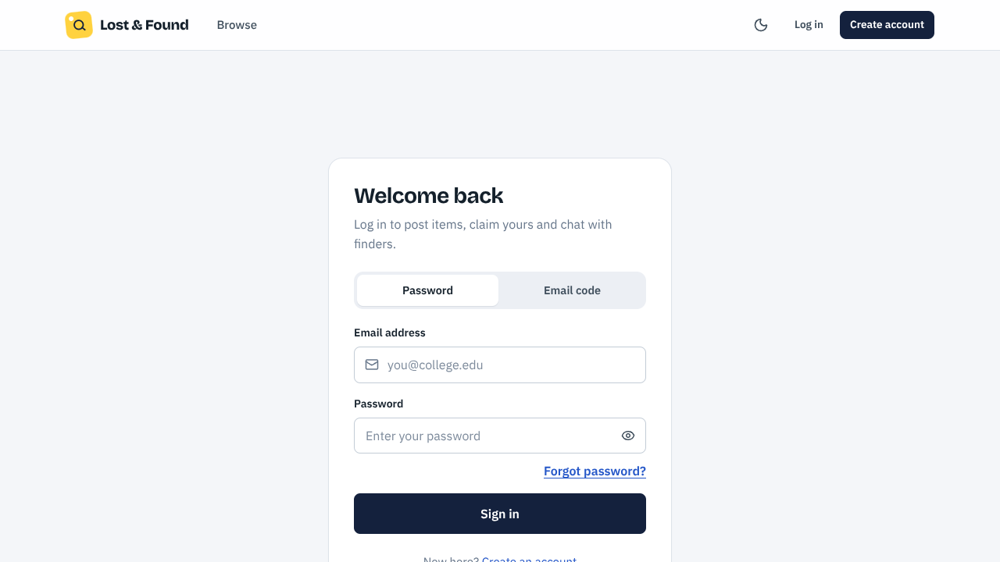<br><b>Private Chat</b></td>
</tr>
<tr>
<td align="center">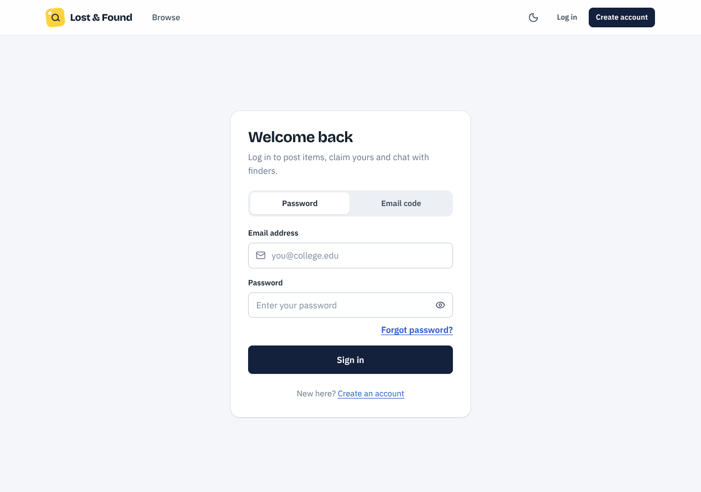<br><b>Report an Item</b></td>
<td align="center">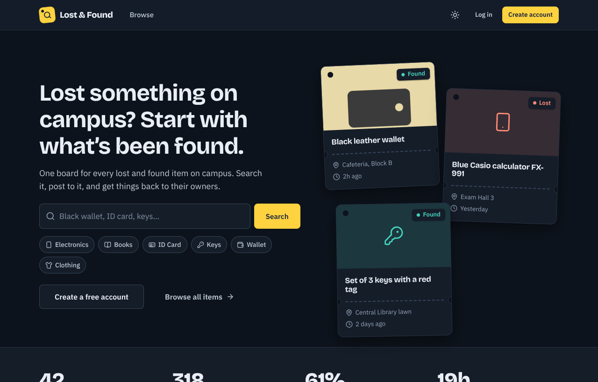<br><b>Dark Theme</b></td>
</tr>
</table>

<p align="center">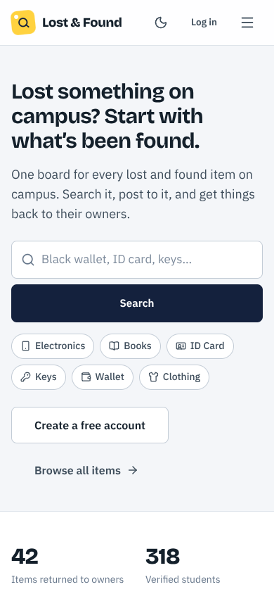<br><b>📱 Mobile Responsive</b></p>

---

## 🔄 How It Works

### A Post's Lifecycle

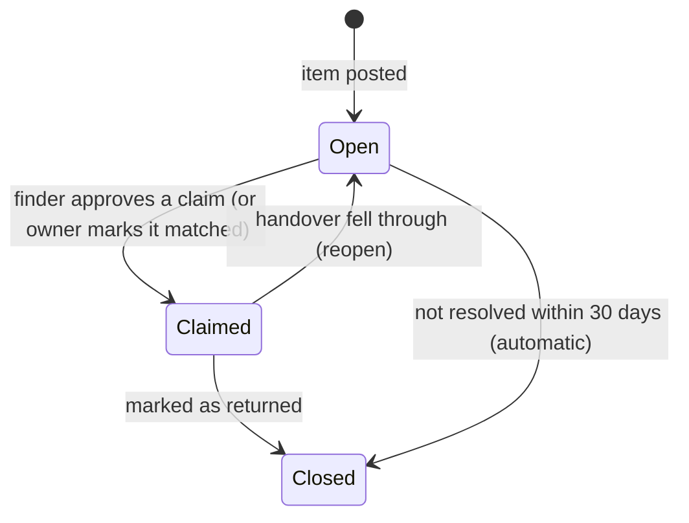

### The Claim Flow (Found Item)

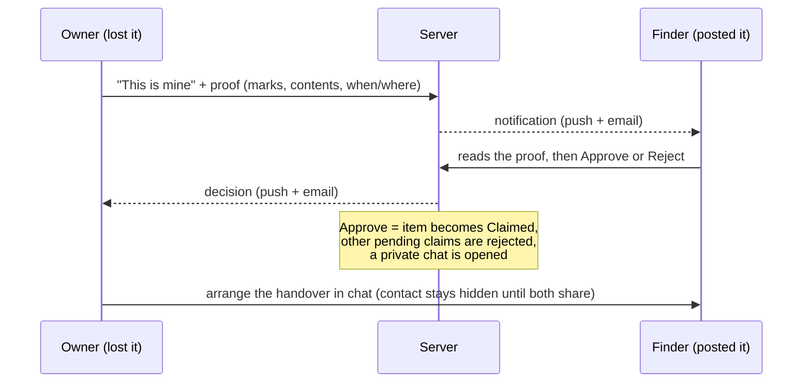

---

## 🏛️ Architecture

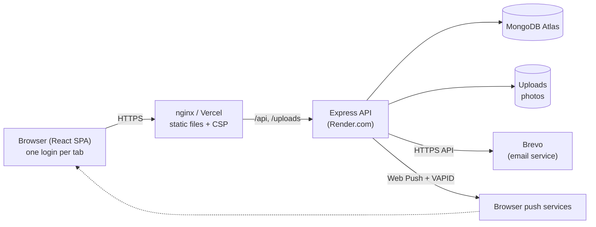

---

## 🚀 Quick Start (Local Development)

### Prerequisites
- **Node.js** 20+ 
- **MongoDB** running locally (or [MongoDB Atlas](https://www.mongodb.com/cloud/atlas) free tier)

### 1. Clone the repo
```bash
git clone https://github.com/abhishekn4352/Campus-Lost-and-Found.git
cd Campus-Lost-and-Found
```

### 2. Start the API
```bash
cd backend
cp .env.example .env     # Set JWT_SECRET; leave EMAIL_* empty (codes print in console)
npm install
npm run dev              # → http://localhost:5000
```

### 3. Start the Website
```bash
cd frontend
npm install
npm run dev              # → http://localhost:3000 (proxies /api to :5000)
```

### 4. Create an Admin (optional)
```bash
cd backend && node scripts/seedAdmin.js
```

> **💡 Tip:** In development, OTP codes are printed directly in the backend console — no email setup needed!

```
[DEV EMAIL] to=you@college.edu subject="Your verification code"
OTP for you@college.edu: 483920
```

---

## ⚙️ Configuration

All settings are environment variables. Full reference in **[DEPLOYMENT.md → Environment variables](DEPLOYMENT.md#2-environment-variables)**.

| Variable | Required | Purpose |
|----------|----------|---------|
| `MONGO_URI` | ✅ | MongoDB connection string |
| `JWT_SECRET` | ✅ | Session signing (32+ random chars in production) |
| `FRONTEND_URL` | ✅ prod | Public URL — used for CORS and email links |
| `BREVO_API_KEY` | ✅ prod | Transactional emails via Brevo HTTPS API |
| `EMAIL_USER` | dev | Gmail address (for local SMTP fallback) |
| `EMAIL_PASS` | dev | Gmail app password |
| `VAPID_PUBLIC_KEY` | optional | Push notifications (`npm run vapid` generates keys) |
| `VAPID_PRIVATE_KEY` | optional | Push notifications (keep secret) |

> In production the API **refuses to start** if a required value is missing or weak, and prints exactly what to fix.

---

## 📂 Project Structure

```
Campus-Lost-and-Found/
├── 📁 backend/                   Express API
│   ├── server.js                 Entry: validates config, connects DB, graceful shutdown
│   ├── app.js                    Middleware stack + routes
│   ├── 📁 config/               Env validation, DB connection, upload path
│   ├── 📁 models/               User, Item, Claim, Conversation, Message, PushSubscription
│   ├── 📁 controllers/          Auth, items, claims, messages
│   ├── 📁 routes/               Auth, items, claims, messages, notifications, push, admin
│   ├── 📁 services/             Claim approval, conversations, item cleanup, push delivery
│   ├── 📁 middleware/           Auth (Bearer), errors, rate limiters, admin guard
│   ├── 📁 utils/                Emails (Brevo + SMTP), validators, image sniffing, cron
│   ├── 📁 scripts/              seedAdmin.js — create the first admin
│   └── 📁 tests/                Jest + Supertest (140 tests, no DB needed)
│
├── 📁 frontend/                  React SPA (Vite)
│   ├── 📁 public/               SW (push), manifest, icons, theme-init
│   ├── 📁 src/
│   │   ├── index.css             Design system (tokens, components, themes)
│   │   ├── 📁 pages/            Home, ItemList, ItemDetail, PostItem, Claims, Chat, admin/*
│   │   ├── 📁 components/       Navbar, ItemCard, ItemForm, Modal, OtpInput, PushControls
│   │   ├── 📁 context/          Auth, Toast, Theme, Confirm, Notifications, Push
│   │   └── 📁 tests/            Vitest + React Testing Library (123 tests)
│   ├── vercel.json               SPA routing for Vercel
│   ├── Dockerfile                Production Docker image
│   └── nginx.conf                Reverse proxy + security headers
│
├── docker-compose.yml            One-command local/production run
├── .github/workflows/ci.yml      CI: tests + build on every push
├── DEPLOYMENT.md                 Production deployment guide
└── README.md                     You are here
```

---

## 📡 API Reference

Base path: `/api` · Auth: `Authorization: Bearer <token>` · Errors: `{ "message": "…" }`

<details>
<summary><b>🔐 Authentication</b></summary>

| Method | Endpoint | Auth | Purpose |
|--------|----------|------|---------|
| `GET` | `/health` | – | Liveness/readiness (503 if DB down) |
| `POST` | `/auth/request-otp` | – | Email a code (`purpose`: register, login, reset) |
| `POST` | `/auth/register-verify` | – | Finish sign-up with code |
| `POST` | `/auth/login` | – | Password login |
| `POST` | `/auth/login-otp` | – | Email-code login |
| `POST` | `/auth/reset-password` | – | Reset password with code |
| `GET` | `/auth/me` | ✔ | Current user profile |
| `PUT` | `/auth/profile` | ✔ | Update name/phone |
| `PUT` | `/auth/password` | ✔ | Change password |
| `POST` | `/auth/email/request` | ✔ | Start email change |
| `POST` | `/auth/email/confirm` | ✔ | Confirm email change |

</details>

<details>
<summary><b>📦 Items</b></summary>

| Method | Endpoint | Auth | Purpose |
|--------|----------|------|---------|
| `GET` | `/items` | – | Browse/search: `q, type, category, location, sort, page, limit` |
| `GET` | `/items/:id` | optional | Item detail (includes your claim if signed in) |
| `POST` | `/items` | ✔ | Create item (multipart: photo upload) |
| `PUT` | `/items/:id` | ✔ | Edit item |
| `DELETE` | `/items/:id` | ✔ | Delete item |
| `GET` | `/items/my-posts` | ✔ | Your posts + pending claim counts |
| `GET` | `/items/stats` | – | Public totals for home page |

</details>

<details>
<summary><b>🏷️ Claims</b></summary>

| Method | Endpoint | Auth | Purpose |
|--------|----------|------|---------|
| `POST` | `/claims/request/:itemId` | ✔ | Claim a found item |
| `GET` | `/claims/my-claims` | ✔ | Claims you sent |
| `GET` | `/claims/received` | ✔ | Claims on your items |
| `PUT` | `/claims/:id/respond` | ✔ owner | Approve or reject |
| `DELETE` | `/claims/:id` | ✔ | Withdraw pending claim |

</details>

<details>
<summary><b>💬 Messages & Notifications</b></summary>

| Method | Endpoint | Auth | Purpose |
|--------|----------|------|---------|
| `POST` | `/messages/start` | ✔ | Open a chat about an item |
| `POST` | `/messages/send` | ✔ | Send a message |
| `GET` | `/messages/conversations` | ✔ | List conversations |
| `GET` | `/messages/:convId` | ✔ | Messages in a conversation |
| `POST` | `/messages/share-contact` | ✔ | Toggle contact sharing consent |
| `GET` | `/notifications/summary` | ✔ | Badge counts |
| `GET` | `/push/config` | – | Push enabled + VAPID key |
| `POST` | `/push/subscribe` | ✔ | Register browser for push |

</details>

<details>
<summary><b>🛡️ Admin</b></summary>

| Method | Endpoint | Auth | Purpose |
|--------|----------|------|---------|
| `GET` | `/admin/dashboard` | admin | Overview stats |
| `GET` | `/admin/items` | admin | All items (searchable/paginated) |
| `GET` | `/admin/claims` | admin | All claims |
| `GET` | `/admin/users` | admin | All users |
| `PUT` | `/admin/users/:id/status` | admin | Suspend/reinstate account |

</details>

---

## 🧪 Testing

```bash
# Backend — 140 tests (Jest + Supertest, no database required)
cd backend && npm test

# Frontend — 123 tests (Vitest + React Testing Library)  
cd frontend && npm test
```

**CI** (`.github/workflows/ci.yml`) runs both suites and a production build on Node 20 and 22 for every push and pull request.

---

## 🔒 Security

| Measure | Detail |
|---------|--------|
| **Privacy by default** | Public APIs expose only poster's name. Email/phone shared only after mutual consent. |
| **Per-tab sessions** | JWT in `sessionStorage` + Bearer header (no cookies). Strict CSP prevents XSS. |
| **OTP hardening** | `crypto.randomInt`, 10 min TTL, 5 wrong guesses burns the code, 30s resend gap, timing-safe comparison. |
| **Rate limiting** | Per-IP limits on API, code requests, logins. Per-user limits on posting, claiming, messaging. |
| **Input validation** | Strict type checks (no NoSQL injection), size limits, HTML-escaped emails, magic-byte image validation. |
| **Config safety** | Refuses to boot in production without strong `JWT_SECRET`, `FRONTEND_URL`, and email credentials. |

---

## 🌐 Deployment

### Live Instance

| Service | URL | Platform |
|---------|-----|----------|
| **Frontend** | [lost-found-campus-based-system.vercel.app](https://lost-found-campus-based-system.vercel.app/) | Vercel |
| **Backend API** | [campus-lostfound-api.onrender.com](https://campus-lostfound-api.onrender.com/api/health) | Render |
| **Database** | MongoDB Atlas (ap-south-1) | Atlas Free M0 |

### Deploy Your Own

See **[DEPLOYMENT.md](DEPLOYMENT.md)** for detailed instructions covering:
- 🐳 Docker Compose (recommended)
- 🖥️ Manual setup (Node + nginx + PM2)
- ☁️ Split hosting (Vercel + Render + Atlas)
- 🔐 HTTPS with Caddy
- 📦 Backups and monitoring

---

## ⚠️ Known Limitations

- **Photos on disk** — Fine with Docker volumes; ephemeral PaaS disks lose them on redeploy. S3/Cloudinary migration is straightforward.
- **Single API instance** — Rate-limit counters are in-process. Multiple replicas need Redis.
- **Not yet implemented** — Account deletion, reporting posts/users, blocking users, Terms/Privacy page, i18n.
- **Push on iOS** — Works only for sites added to the Home Screen.

---

## 🤝 Contributing

1. Fork the repository
2. Create your feature branch (`git checkout -b feature/amazing-feature`)
3. Commit your changes (`git commit -m 'Add amazing feature'`)
4. Push to the branch (`git push origin feature/amazing-feature`)
5. Open a Pull Request

---

## 📄 License

This project is licensed under the **MIT License** — see the [LICENSE](LICENSE) file for details.

---

## 👨‍💻 Author

**Abhishek Nimbalkar**

[](https://github.com/abhishekn4352)

---

<div align="center">

**⭐ Star this repo if you found it useful!**

Made with ❤️ for campus communities

</div>
