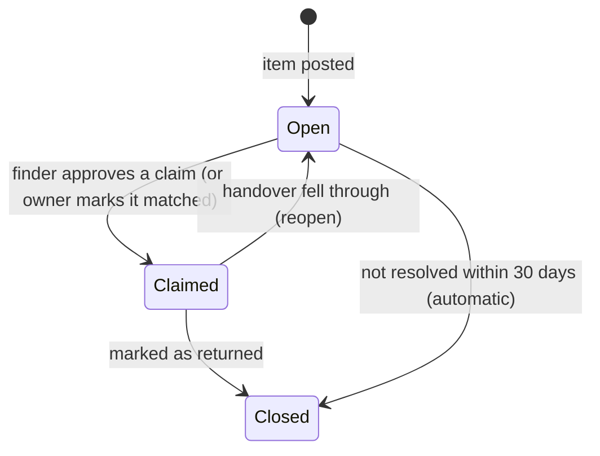
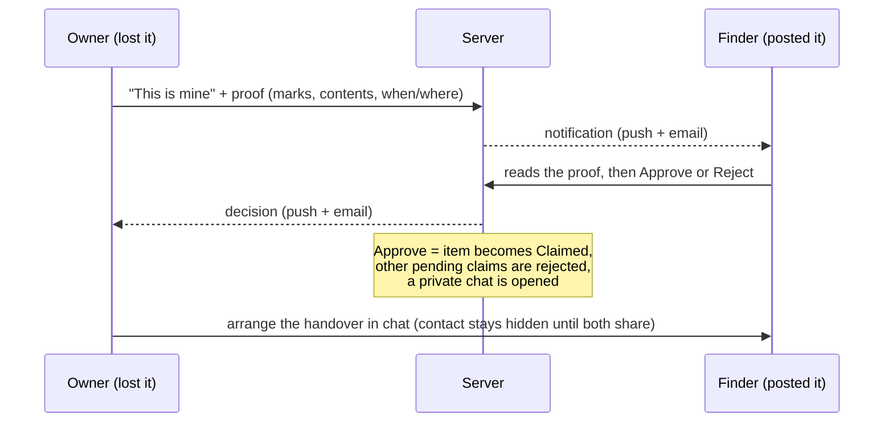
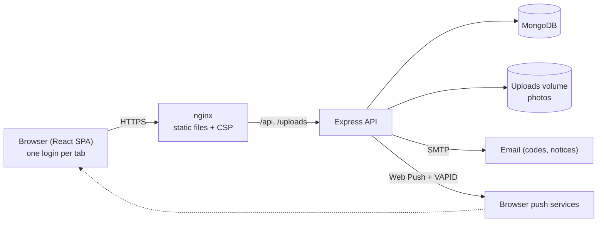

# Campus Lost & Found

A full-stack web app for a college campus. Students report **lost** items, post **found** items, **claim** what's theirs and chat to arrange the handover — without their phone number or email being shown to strangers.

<p align="center">
  
</p>

**Stack:** React 18 + Vite · Node.js + Express · MongoDB (Mongoose) · Web Push (VAPID) · Nodemailer · Docker/nginx

> **Documentation:** this README (overview + local development) · **[DEPLOYMENT.md](DEPLOYMENT.md)** (going live: Docker, VPS, HTTPS, backups, troubleshooting) · [CHANGES.md](CHANGES.md) (what was fixed/added and why)

---

## Contents

[Features](#features) · [Screenshots](#screenshots) · [How it works](#how-it-works) · [Architecture](#architecture) · [Quick start](#quick-start-local-development) · [Configuration](#configuration) · [Project structure](#project-structure) · [API reference](#api-reference) · [Testing](#testing) · [Security](#security) · [Known limitations](#known-limitations)

---

## Features

| Area | What you get |
|---|---|
| **The board** | Browse and search every lost/found item. Search text, type, category and sort **combine**; filters live in the URL (shareable, back-button friendly); results are paginated. |
| **Posting** | Title, description, category, date, location and an optional photo. Photos are checked by type, size (5 MB) **and real file header**. Owners can **edit** a post (fix details, replace/remove the photo) until it is closed. |
| **Claims** | On a *found* item, "This is mine" asks the claimant to prove it. The finder **reviews** the claim and approves or rejects it. Approval is atomic, closes rival claims and opens a chat. Nothing is ever auto-approved. |
| **Private chat** | One chat per item. Phone and email are revealed **only after both people choose to share** — enforced by the API, not just hidden in the UI. |
| **Accounts** | Email-code registration, password **or** email-code login, forgot/change password, **change email** (password + a code sent to the new address; the old address is notified), one account per college ID. |
| **Several accounts, one browser** | Every browser **tab has its own login**. A new tab starts signed out, and different tabs can be different people at the same time. |
| **Push notifications** | Optional. Browser notifications for new messages, claims on your items and decisions on your claims — even when the site is closed. They never contain message text. |
| **Admin** | Overview, searchable/paginated items, claims and students; delete content, resolve claims, suspend/reinstate accounts. |
| **Housekeeping** | Posts auto-close after 30 days; abandoned sign-ups are cleaned up daily. |
| **UI** | Own design system (no UI framework), light & dark themes, mobile bottom navigation, skeleton loaders, accessible dialogs, installable (web app manifest). |

## Screenshots

| | |
|---|---|
|  **Browse & search** |  **An item, with claim / message actions** |
|  **Finder reviews claims** |  **Private chat — contact shared by both** |
|  **Report an item** |  **Dark theme** |

<p align="center"></p>

## How it works

**A post's life**



**The claim flow** (for a *found* item)



For a *lost* item, the person who found it simply taps **"I found this"**, which opens a private chat with the owner.

## Architecture



Sessions are a JWT kept in `sessionStorage` and sent as a `Bearer` header (no cookies) — that is what makes one-login-per-tab possible. See [Security](#security) for the trade-offs.

## Quick start (local development)

**Prerequisites:** Node.js 20+, and MongoDB running locally (or a free MongoDB Atlas connection string).

```bash
# 1. API
cd backend
cp .env.example .env     # set JWT_SECRET; leave EMAIL_* empty (codes are then printed in this console)
npm install
npm run dev              # http://localhost:5000

# 2. Website — in a second terminal
cd frontend
npm install
npm run dev              # http://localhost:3000  (proxies /api and /uploads to :5000)

# 3. Optional: an admin account (uses SEED_ADMIN_* from backend/.env)
cd backend && node scripts/seedAdmin.js
```

Open <http://localhost:3000>, click **Create account**, and look at the API console for a line like

```
[DEV EMAIL] to=you@college.edu subject="Your verification code"
OTP for you@college.edu: 483920
```

Type that code in the browser. That is the whole sign-up flow — no email account needed in development.

**Try the "two accounts in one browser" feature:** sign in as one person, open a second tab, and sign in as someone else. Each tab keeps its own session.

## Configuration

All settings are environment variables. The backend reads `backend/.env`; the Docker setup reads the root `.env`. The full table (required vs optional, defaults, examples) is in **[DEPLOYMENT.md → Environment variables](DEPLOYMENT.md#2-environment-variables)**. The ones you will touch first:

| Variable | Needed for |
|---|---|
| `MONGO_URI` | database connection |
| `JWT_SECRET` | signing sessions (32+ random characters in production) |
| `FRONTEND_URL` | the site's public URL — CORS and links in emails |
| `EMAIL_USER`, `EMAIL_PASS` | sending codes/notifications (Gmail address + app password) |
| `VAPID_PUBLIC_KEY`, `VAPID_PRIVATE_KEY` | push notifications (`npm run vapid` generates them) |

In production the API **refuses to start** if a required value is missing or weak, and prints exactly what to fix.

## Project structure

```
.
├── backend/                  Express API
│   ├── server.js             entry: validates config, connects DB, graceful shutdown
│   ├── app.js                middleware stack + routes (importable for tests)
│   ├── config/               env validation, DB connection, upload path
│   ├── models/               User, Item, Claim, Conversation, Message, PushSubscription
│   ├── controllers/          auth, items, claims, messages
│   ├── routes/               auth, items, claims, messages, notifications, push, admin
│   ├── services/             claim approval, conversations, item cleanup, push delivery
│   ├── middleware/           auth (Bearer), errors, rate limiters, admin guard
│   ├── utils/                emails, validators, image sniffing, cron jobs …
│   ├── scripts/seedAdmin.js  create the first admin
│   └── tests/                Jest + Supertest (models mocked, no DB needed)
├── frontend/                 React SPA (Vite)
│   ├── public/               sw.js (push), manifest, icons, theme-init.js
│   ├── src/
│   │   ├── index.css         the whole design system (tokens, components, themes)
│   │   ├── pages/            Home, ItemList, ItemDetail, PostItem, EditItem, Claims, Chat*, Profile, admin/*
│   │   ├── components/       Navbar, ItemCard, ItemForm, Modal, OtpInput, PushControls …
│   │   ├── context/          Auth, Toast, Theme, Confirm, Notifications, Push
│   │   ├── push/             browser-side Web Push helpers
│   │   └── tests/            Vitest + React Testing Library
│   └── Dockerfile, nginx.conf, security-headers.conf
├── docker-compose.yml        mongo + api + website
├── .env.example              settings for docker compose
├── .github/workflows/ci.yml  tests + build on every push
├── DEPLOYMENT.md  CHANGES.md  README.md
└── docs/screenshots/
```

## API reference

Base path `/api`. **Auth** = send `Authorization: Bearer <token>` (returned by the login/register calls). Responses are JSON; errors look like `{ "message": "…" }`.

| Method & path | Auth | Purpose |
|---|---|---|
| `GET /health` | – | liveness/readiness (503 if the database is down) |
| **Auth** | | |
| `POST /auth/request-otp` | – | email a code (`purpose`: `register`, `login`, `reset`) |
| `POST /auth/register-verify` | – | finish sign-up with the code |
| `POST /auth/login` · `POST /auth/login-otp` | – | password login · email-code login |
| `POST /auth/reset-password` | – | set a new password with an emailed code |
| `GET /auth/me` · `PUT /auth/profile` | ✔ | current user · update name/phone |
| `PUT /auth/password` | ✔ | change password |
| `POST /auth/email/request` · `/confirm` | ✔ | change email (password → code to the new address → confirm) |
| `GET /auth/logout` | – | no-op (the client forgets its own token) |
| **Items** | | |
| `GET /items` | – | browse/search: `q, type, category, location, sort, page, limit` → `{items,total,page,pages}` |
| `GET /items/:id` | optional | one item (includes your own claim when signed in) |
| `POST /items` · `PUT /items/:id` · `DELETE /items/:id` | ✔ | create (multipart) · edit (multipart, or JSON for a status change) · delete |
| `GET /items/my-posts` | ✔ | your posts + pending-claim counts |
| `GET /items/stats` | – | public totals for the home page |
| **Claims** | | |
| `POST /claims/request/:itemId` | ✔ | claim a found item `{message}` |
| `GET /claims/my-claims` · `GET /claims/received` | ✔ | claims you sent · claims on your items |
| `PUT /claims/:id/respond` | ✔ owner/admin | `{action: "approve" or "reject", note}` |
| `DELETE /claims/:id` | ✔ | withdraw your pending claim |
| **Messages** | | |
| `POST /messages/start` · `POST /messages/send` | ✔ | open a chat about an item · send a message |
| `GET /messages/conversations[/:id]` · `GET /messages/:convId` | ✔ | list / one conversation · its messages (`?after=`) |
| `POST /messages/share-contact` | ✔ | toggle *your* consent to share contact details |
| **Other** | | |
| `GET /notifications/summary` | ✔ | counts for the navbar badges |
| `GET /push/config` | – | is push enabled + public VAPID key |
| `POST /push/subscribe` · `/unsubscribe` · `/test` | ✔ | register / remove this browser · send yourself a test |
| `/admin/*` | ✔ admin | `dashboard`, `items`, `claims`, `users`, `users/:id/status` |

## Testing

```bash
cd backend  && npm test    # 140 tests — Jest + Supertest, no database required
cd frontend && npm test    # 123 tests — Vitest + React Testing Library
```

CI (`.github/workflows/ci.yml`) runs both suites and the production build on Node 20 and 22 for every push and pull request.

The unit tests mock the database. Before release, the full flow was also exercised against a running API and database (register → post → claim → approve → chat → contact sharing → admin → push delivery) and in a real browser; see the end of [CHANGES.md](CHANGES.md) for exactly what was covered and what could not be.

## Security

* **Privacy by default:** public APIs expose only a poster's name. Conversation APIs include the other person's email/phone only after *both* have shared.
* **Per-tab sessions:** the JWT lives in `sessionStorage` and is sent as a Bearer header; there are no cookies. Trade-off: unlike an HttpOnly cookie, page JavaScript can read it, so the site ships a strict **Content-Security-Policy** (`frontend/security-headers.conf`: no inline or third-party scripts) and React escapes all content. Tokens last 7 days but vanish when the tab closes, and can't be revoked individually (suspend the account instead).
* **Codes:** generated with `crypto.randomInt`, valid 10 minutes, 5 wrong guesses then burned, 30-second resend gap; unknown emails get an identical response.
* **Abuse limits:** per-IP limits on the API, code requests and logins; per-user limits on posting, claiming and messaging.
* **Input:** strict type checks (no NoSQL-operator injection), size limits, HTML-escaped emails, magic-byte image validation, errors masked in production.
* **Config safety:** the API won't boot in production without a strong `JWT_SECRET`, `FRONTEND_URL` and email credentials.

## Known limitations

Worth knowing before you rely on it:

* **Photos are stored on the server's disk.** Fine with a Docker volume or VPS disk; on hosts with ephemeral disks (many free PaaS tiers) they disappear on redeploy. Moving to S3/Cloudinary is a contained change (`itemController.js`, `services/itemCleanup.js`).
* **Email uses Gmail's SMTP** (`utils/sendOTP.js`). Fine for a pilot (Gmail limits daily volume); another provider needs a small change to the transporter.
* **One API instance.** Rate-limit counters and the nightly cron jobs live in the process. Don't run several replicas without moving the counters to a shared store (e.g. Redis) and running the cron on one node.
* **Not implemented:** deleting your own account, reporting a post/user, blocking a user, a Terms/Privacy page, multiple languages. (Several of these are required before publishing to an app store.)
* **Push delivery** depends on the browser vendor's push service; on iPhone it works only for sites added to the Home Screen.
